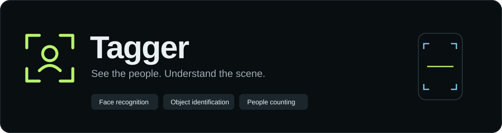

<p align="center">
  
</p>

<p align="center">
  
  
  
</p>

**Tagger** turns your Android camera into a live viewfinder for familiar faces, common objects, and the people around you. Register people with their permission, add appearance samples, and choose exactly what information appears on screen. Recognition runs locally, with no account or server required in the app.

<p align="center">
  <a href="https://github.com/el-capitano/Tagger/releases/latest"><strong>Download the Android APK</strong></a>
  &nbsp; | &nbsp;
  <a href="#getting-started">Getting started</a>
  &nbsp; | &nbsp;
  <a href="#build-from-source">Build from source</a>
</p>

> **Development preview:** Tagger is under active development. Camera accuracy, counting reliability, and device compatibility still need real-world validation. It is not an authentication or access-control system.

## What Tagger can do

| Feature | What you get |
| --- | --- |
| Face recognition | Tracking boxes and information panels for people you have registered. |
| Multiple appearances | Normal, Smiling, Angry, Glasses, or custom captures under one person. |
| Object identification | Labels for people, cars, trucks, motorbikes, bicycles, airplanes, animals, furniture, and other supported categories. |
| People counting | An optional estimate of everyone currently visible, including unregistered people. |
| Camera controls | Front/rear switching, pause/resume, landscape layout, and fullscreen mode. |
| Display controls | Independently show or hide boxes, labels, profile details, scores, and counters. |
| Local profiles | Encrypted enrollment data, editable details, and individual appearance or person deletion. |

## Install

### On your Android phone

1. Use a phone or tablet running **Android 8.0 or newer** with a camera.
2. Open the [latest release](https://github.com/el-capitano/Tagger/releases/latest). Because this repository is private, sign in to a GitHub account with access.
3. Download the APK attached to the release, such as `Tagger-v1.2.1-debug.apk`.
4. Open the downloaded file. If Android asks, allow your browser or file manager to **install unknown apps**, then continue with installation.
5. Launch **Tagger** and grant camera access.

The release APK is a debug-signed development build. You do not need Android Studio to install it.

### With ADB

Enable USB debugging on your device, connect it to your computer, authorize the connection, then run:

```shell
adb devices
adb install -r Tagger-v1.2.1-debug.apk
```

**Updating an existing installation:** install over the current app using a build signed with the same key. Do not uninstall Tagger or clear its storage if you want to keep registered people. The Android package ID remains `com.whoisthis.app` so the Tagger rename can update earlier builds without changing their data location.

## Getting started

### 1. Choose your camera

Tap **Use front** in the camera view to select the selfie camera, or **Use rear** to switch back. The live label shows the active camera. Use **Pause** when you want to stop the camera preview and analysis.

### 2. Register someone

1. Tap **Register face**, or open **People → New person**.
2. Enter their name, role or relationship, and optional notes.
3. Choose an appearance label, such as **Normal**.
4. Confirm that the person agrees to the capture.
5. Keep one person in view and follow the prompts: look straight ahead, turn slightly to one side, then the other. Tagger captures six samples automatically.

Use even lighting, keep the full face visible, and hold the selected appearance while following the angle prompts. The profile is available for recognition after saving completes.

### 3. Add more appearances

Open **People**, find the person, and tap **Add appearance**. Capture a different expression or look, such as **Smiling**, **Angry**, or **Glasses**. All appearances match the same identity; they do not create duplicate people.

- Up to **20 appearances** can be saved per person.
- Open **Manage** to remove an appearance or edit personal details.
- At least one appearance must remain; delete the person to remove everything.
- Changing cameras or camera layout during capture restarts the samples while retaining the entered details.

Appearance labels name examples you deliberately capture. They are **not automatic emotion predictions**. Gender and age category are optional, user-entered profile details; Tagger does not guess them from the camera.

### 4. Choose what appears on screen

Tap **On screen** in the camera view, or open **Controls**.

| Option | Purpose |
| --- | --- |
| Face recognition | Match registered people. |
| Object identification | Show supported object and scene labels. |
| People counter | Count people currently visible, without requiring registration. |
| Recognized faces counter | Show how many visible faces have matched a registered person. |
| Bounding boxes | Draw outlines around faces and objects. |
| Names and labels | Show identity panels and object names. |
| Profile details | Display entered roles, notes, and optional attributes. |
| Model scores | Show raw similarity and detection scores. |

For **counting only**, enable **People counter** and disable **Face recognition** and **Object identification**. Display preferences are saved between launches.

Rotate the device for the landscape camera-and-controls layout. Tap **Fullscreen** to expand the view, then **Exit fullscreen** or Android Back to restore the layout.

## Understanding the results

| Indicator | Meaning |
| --- | --- |
| Green face box | A stable match to a registered person. |
| Amber face box | An unknown face or guidance to improve capture quality. |
| Blue object box | A supported object category. |
| Scene label | A description of the overall view, such as Building or Room; it does not have a localized box. |
| `+` beside the people count | The object detector reached its result limit, so more people may be present. |

The people counter combines face and body detections without counting the same detection twice. It estimates **people visible now**, not unique visitors across a session. Small, overlapping, partly hidden, or poorly lit people can be missed.

The object model returns up to 25 object detections per frame and covers common COCO categories. Buildings and homes may receive broader scene labels such as **Building** or **Room**. It does not recognize every possible object.

Face similarity is a model score, **not an accuracy percentage**. The default face threshold is `0.72`, with a required lead over other people and three consecutive matching observations. Use **Controls** to tune the threshold against registered and unregistered people in your own setting.

Photos or screens can fool recognition: this version has **no liveness or anti-spoofing verification**.

## Privacy and data

- Camera images and face crops are processed in memory and are not saved.
- Models are bundled; the app manifest removes Internet and network-state permissions.
- Profile details and face templates are encrypted with **AES-GCM**, using a key held by **Android Keystore**.
- Profile writes are atomic. Android backup and device transfer are disabled.
- Existing registrations from earlier builds are preserved as a **Normal** appearance with the same person ID and samples.
- Deleting a person removes their details and appearance templates from the app database. Uninstalling or clearing app storage removes enrollment data.

## Build from source

### Requirements

- Git and access to this private repository.
- Android Studio with **Android SDK 36**.
- **JDK 17 or 21**.
- **NDK 28.2.13676358**, available through Android Studio's SDK Manager.

The Gradle wrapper is included. Model files are committed, so there are no API keys or separate model downloads to configure. The first build needs Internet access to resolve build dependencies.

```shell
git clone https://github.com/el-capitano/Tagger.git
cd Tagger
```

Open the project in Android Studio and let Gradle sync. Set `sdk.dir` in an untracked `local.properties` file, or configure `ANDROID_HOME` for command-line builds.

**Windows PowerShell**

```powershell
.\gradlew.bat :app:assembleDebug
```

**macOS / Linux**

```shell
./gradlew :app:assembleDebug
```

The APK is written to:

```text
app/build/outputs/apk/debug/app-debug.apk
```

To install that build on a connected device:

```shell
adb install -r app/build/outputs/apk/debug/app-debug.apk
```

### Checks

```powershell
.\gradlew.bat :app:testDebugUnitTest :app:lintDebug :app:assembleDebugAndroidTest
```

Run device tests with an emulator or physical device connected:

```powershell
.\gradlew.bat :app:connectedDebugAndroidTest
```

The unit suite covers matching across appearances, identity ambiguity, enrollment, legacy-profile migration, serialization, overlapping-person counting, and box geometry. Android tests cover model inference, encrypted persistence, camera switching, and preview mirroring.

**Validation:** 17 unit tests and local object-model checks for empty, one-person, and two-person images have passed. The build and Android test APK compile. Full Android runtime and UI validation remains incomplete because the most recent emulator run was interrupted by host disk-space limits. Lint's remaining warnings concern newer dependency versions. Physical-camera accuracy has not been measured.

## Troubleshooting

| Issue | What to try |
| --- | --- |
| Camera access was denied | Allow Camera in Android's app settings, then return to Tagger. |
| The selected camera is unavailable | Tap **Use front** or **Use rear**, or close another app using the camera. |
| A face stays unknown | Improve lighting, move closer, check the appearance samples, and test the match threshold. |
| Capture stops progressing | Keep one face visible and follow the head-angle prompts. Cancel and restart if tracking changed. |
| A count looks wrong | Improve the view of hidden/overlapping people; the count is an estimate. |
| Installation reports a signature mismatch | Use a build signed with the original key. Uninstalling to bypass the error deletes registered profiles. |
| Saved profiles cannot be unlocked | Avoid clearing storage unless you intend to reset enrollment. Tagger blocks writes rather than overwrite unreadable data. |

## Technology and model credits

Tagger uses **Kotlin**, **Jetpack Compose**, **CameraX**, **Google ML Kit**, and **LiteRT**.

| Component | Purpose | Source / terms |
| --- | --- | --- |
| MobileFaceNet | 192-dimensional face embeddings | [Pinned upstream model](https://github.com/hugocornellier/face_detection_tflite/tree/b94c88de9fd9ae0b0faee156693de90ea707319e), distributed there under Apache 2.0. |
| EfficientDet-Lite0 | Common object and person detection | [Google's TFLite model](https://storage.googleapis.com/download.tensorflow.org/models/tflite/task_library/object_detection/android/lite-model_efficientdet_lite0_detection_metadata_1.tflite), Apache 2.0. |
| ML Kit face detection | Face locations and landmarks | [Google ML Kit](https://developers.google.com/ml-kit/vision/face-detection/android), under its SDK terms. |
| ML Kit image labeling | Selected scene labels | [Google ML Kit](https://developers.google.com/ml-kit/vision/image-labeling/android), under its SDK terms. |

Model provenance, hashes, and license notices are packaged in `app/src/main/assets`. The public-domain Grace Hopper portrait used by instrumentation tests comes from [TensorFlow's example images](https://storage.googleapis.com/download.tensorflow.org/example_images/grace_hopper.jpg); it is not included in the installed app or pre-enrolled as a person.
